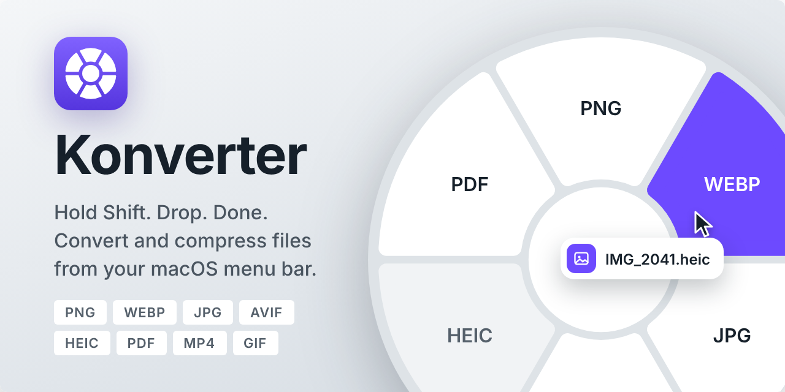
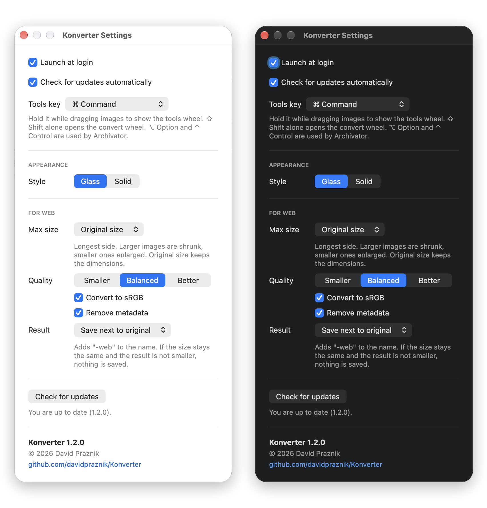

  

  Hold <b>⇧ Shift</b> while dragging a file to convert it, <b>⌘ Command</b> to prepare images for the web or strip metadata. 
  Lives in your menu bar and is built to be energy efficient: it only does work while you are using it. The result is saved next to the original.

  
  
  

## Energy efficient

Konverter is optimised for low energy use. It only listens for a mouse press. Drag detection runs only while the mouse button is held down and stops as soon as you release it, and the CPU is busy only for the moment of a conversion. Apart from the optional update check (once a day), nothing runs in the background, so an idle Konverter does not drain your battery.

## Formats

| Input | Output |
| --- | --- |
| Images | PNG, WEBP, JPG, AVIF, HEIC, PDF, TIFF, BMP |
| Video | MP4, GIF, M4A (audio only) |

Several files can be dropped at once. If a file with the same name exists, a number is added (`photo (1).webp`).

## Usage

1. Start Konverter. It lives in the menu bar.
2. Drag one or more files from Finder.
3. While dragging, hold **⇧ Shift** for the conversion wheel, or **⌘ Command** for the image tools wheel (images only). The wheel opens at the cursor.
   Switching apps with ⌘ Tab while holding a file opens the tools wheel by accident? Change the tools key to **⇧⌘** in Settings ([details](#tools-key)).
4. Drop the files on a segment. The result is saved next to the original.

Dropping on the centre or between segments does nothing. The segment with the file's own format is dimmed. While you drag, the centre of the wheel shows the number of files and their total size, and after **For web** it shows how much space was saved.

## Image tools

The **⌘ Command** wheel has two tools for images:

| Tool | Formats | What it does |
| --- | --- | --- |
| For web | PNG, JPG, WEBP, HEIC | Prepares the image for publishing in one step: sets the longest side (larger images are shrunk, smaller ones enlarged, or keep the original size), compresses with the chosen quality, converts colours to sRGB and removes metadata. Saves `name-web.ext`, or replaces the original (it goes to the Trash). PNG stays lossless. If the size stays the same and the file does not get smaller, nothing is saved. |
| Strip metadata | JPG, PNG, HEIC, WEBP | Removes EXIF, location and other metadata, nothing else changes. Saves `name-clean.ext`. |

## Settings

Menu bar icon, Settings…

- Launch at login, check for updates (GitHub releases, optional automatic check once a day).
- Tools key (see below).
- **Style**: *Glass* (translucent wheel carrier) or *Solid* (the classic look).
- **For web**: max size (original, 3840, 2560, 1920, 1600, 1280, 1024 or 800 px), quality (Smaller, Balanced, Better), convert to sRGB, remove metadata, and whether the result is saved next to the original or replaces it.

  

## Tools key

By default the image tools wheel opens when you hold **⌘ Command** while dragging. The catch: if you hold a dragged file and switch apps with **⌘ Tab**, the wheel pops up by accident.

If that bothers you, open **Settings > Tools key** and choose **⇧⌘ Shift + Command**. The tools wheel then needs both keys, so **⌘ Tab** no longer triggers it. **⇧ Shift** alone still opens the conversion wheel (after a short 0.15 s delay, so it does not flash before the tools wheel).

⌥ Option and ⌃ Control are not offered because [Archivator](https://github.com/davidpraznik/Archivator) uses them.

## Requirements

- macOS 14.6 or later (tested on macOS 27 only)
- Xcode to build from source

## Build

1. Clone the repository and open `Konverter.xcodeproj`.
2. Xcode resolves the `libwebp` Swift package on first open.
3. Select the **Release** scheme for the best conversion speed and run.

The app does not use the App Sandbox. Detecting a file drag needs no special permissions.

## Opening a downloaded build

Builds from GitHub are not notarized, so macOS blocks the app on first launch. To open it:

1. Try to open Konverter once and close the warning.
2. Open **System Settings > Privacy & Security** and scroll to the bottom.
3. Click **Open Anyway** next to the message about Konverter, then confirm.

This is needed only once.

## About

I am a UX/UI and product designer. I made Konverter for my own needs, as a tool I use every day to convert and compress images and video while working on design and product projects. Many open source tools have helped me deliver my work over the years, so I am sharing this one publicly to give something back. It is free and MIT licensed. Bug reports and ideas are welcome in [Issues](https://github.com/davidpraznik/Konverter/issues).

Read more (in Slovenian): [Konverter: brezplačna macOS aplikacija za pretvarjanje in stiskanje datotek](https://davidpraznik.com/konverter-pretvornik-datotek-macos/)

## Third-party components

- [libwebp](https://chromium.googlesource.com/webm/libwebp) (BSD 3-Clause), WebP encoding.
- [Inter](https://rsms.me/inter/) (SIL Open Font License 1.1), interface typeface. The licence is included as `Inter-LICENSE.txt`.

## Licence

MIT, see [LICENSE](LICENSE). © 2026 David Praznik.
